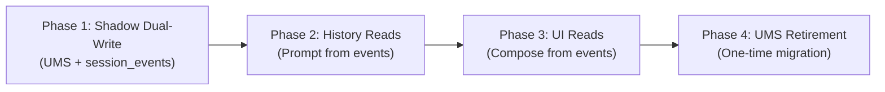
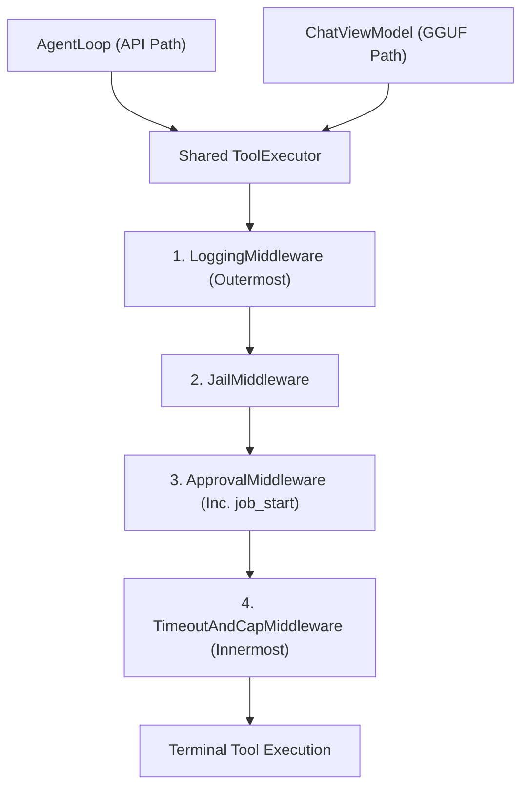

# DeepSeek-Harness Architecture Specification for BIT

**Status:** Design Proposal  
**Scope:** Core Agent Engine, Middleware Pipeline, Workspace Seams, Event Sourcing, Storage Migration  

---

## 1. Storage Source of Truth & Staged Migration Plan

### Current State Analysis
- **Finding:** **UMS (`UmsChatRepository`)** backed by `UnifiedMemorySystem` is the sole source of truth for chat messages in production. It persists monolithic `com.bit.models.messages.Messages` objects indexed by tags (`Tags.Message.MSG_ID`, `Tags.Message.CHAT_ID`, `Tags.Message.TIMESTAMP`).
- **Orphaned Room Schema:** The Room entity `com.bit.data.local.MessageEntity`:
  ```kotlin
  @Entity(tableName = "messages")
  data class MessageEntity(
      @PrimaryKey val id: String,
      val conversationId: String,
      val parentId: String? = null,
      val text: String,
      val thoughts: String? = null,
      val status: MessageStatus = MessageStatus.SUCCESS,
      val participant: Participant = Participant.USER,
      val timestamp: Long = System.currentTimeMillis(),
      val modelName: String? = null,
      val runId: String? = null,
      val runSequence: Int = 0,
      val consumedAtPass: Int = 0
  )
  ```
  is **not registered** in `AppDatabase` v26 (`entities = [Model::class, ModelConfig::class, InstalledRag::class, Persona::class, AiMemory::class, KnowledgeEntity::class, KnowledgeRelation::class, MemoryNote::class, WorkspaceEntity::class]`). It is completely unused by production code.
- **Problem with Current UMS Storage:** UMS stores assistant turns as monolithic records with nested JSON strings (`toolChainSteps`, `executionSteps`). It does not support append-only event reconstruction, branching without record mutation, or strict schema validation.

### Room Database Schema for Events (`AppDatabase` v27)
```kotlin
package com.bit.data.local

import androidx.room.*
import kotlinx.coroutines.flow.Flow

@Entity(
    tableName = "session_events",
    indices = [
        Index(value = ["sessionId", "runId", "sequenceNumber"], unique = true),
        Index(value = ["sessionId", "timestamp"]),
        Index(value = ["sessionId", "parentId"])
    ]
)
data class SessionEventEntity(
    @PrimaryKey val eventId: String,
    val sessionId: String,
    val runId: String,
    val parentId: String? = null,
    val sequenceNumber: Long,
    val timestamp: Long,
    val eventType: String, // turn_start, user_message, env_context, reasoning, tool_call, tool_result, assistant_message, turn_end
    val payloadJson: String
)

@Dao
interface SessionEventDao {
    @Insert(onConflict = OnConflictStrategy.ABORT)
    suspend fun insertEvent(event: SessionEventEntity)

    @Insert(onConflict = OnConflictStrategy.ABORT)
    suspend fun insertEvents(events: List<SessionEventEntity>)

    @Query("SELECT * FROM session_events WHERE sessionId = :sessionId AND runId = :runId ORDER BY sequenceNumber ASC")
    fun observeEventsForRun(sessionId: String, runId: String): Flow<List<SessionEventEntity>>

    @Query("SELECT * FROM session_events WHERE sessionId = :sessionId AND runId = :runId ORDER BY sequenceNumber ASC")
    suspend fun getEventsForRun(sessionId: String, runId: String): List<SessionEventEntity>

    @Query("SELECT * FROM session_events WHERE sessionId = :sessionId ORDER BY sequenceNumber ASC")
    suspend fun getAllEventsForSession(sessionId: String): List<SessionEventEntity>

    @Query("SELECT MAX(sequenceNumber) FROM session_events WHERE sessionId = :sessionId")
    suspend fun getLatestSequenceNumber(sessionId: String): Long?
}
```

### Mapping Legacy UMS Messages to Events
To guarantee that 100% of historical chats remain readable upon migration, `LegacyUmsMessageMapper` unpacks legacy monolithic records into append-only event sequences:
```kotlin
object LegacyUmsMessageMapper {
    fun mapUmsMessageToEvents(
        sessionId: String,
        runId: String,
        message: com.bit.models.messages.Messages,
        startSequence: Long
    ): List<SessionEventEntity> {
        val events = mutableListOf<SessionEventEntity>()
        var seq = startSequence

        when (message.role) {
            com.bit.models.messages.Role.User -> {
                events.add(
                    SessionEventEntity(
                        eventId = message.msgId,
                        sessionId = sessionId,
                        runId = runId,
                        parentId = message.parentId,
                        sequenceNumber = ++seq,
                        timestamp = message.timestamp,
                        eventType = "user_message",
                        payloadJson = Json.encodeToString(
                            SessionEvent.UserMessage(
                                eventId = message.msgId,
                                sessionId = sessionId,
                                runId = runId,
                                sequenceNumber = seq,
                                timestamp = message.timestamp,
                                text = message.content.content
                            )
                        )
                    )
                )
            }
            com.bit.models.messages.Role.Assistant -> {
                events.add(
                    SessionEventEntity(
                        eventId = "start_${message.msgId}",
                        sessionId = sessionId,
                        runId = runId,
                        parentId = message.parentId,
                        sequenceNumber = ++seq,
                        timestamp = message.timestamp,
                        eventType = "turn_start",
                        payloadJson = "{}"
                    )
                )
                // Unpack reasoning if present
                message.executionSteps?.steps?.filter { it.type == "thought" }?.forEach { thought ->
                    events.add(
                        SessionEventEntity(
                            eventId = "thought_${UUID.randomUUID()}",
                            sessionId = sessionId,
                            runId = runId,
                            parentId = message.msgId,
                            sequenceNumber = ++seq,
                            timestamp = message.timestamp,
                            eventType = "reasoning",
                            payloadJson = Json.encodeToString(
                                SessionEvent.Reasoning(
                                    eventId = UUID.randomUUID().toString(),
                                    sessionId = sessionId,
                                    runId = runId,
                                    sequenceNumber = seq,
                                    timestamp = message.timestamp,
                                    thought = thought.content
                                )
                            )
                        )
                    )
                }
                // Unpack tool calls and results
                message.toolChainSteps?.forEach { step ->
                    val callId = "call_${UUID.randomUUID()}"
                    events.add(
                        SessionEventEntity(
                            eventId = "call_$callId",
                            sessionId = sessionId,
                            runId = runId,
                            parentId = message.msgId,
                            sequenceNumber = ++seq,
                            timestamp = message.timestamp,
                            eventType = "tool_call",
                            payloadJson = Json.encodeToString(
                                SessionEvent.ToolCall(
                                    eventId = UUID.randomUUID().toString(),
                                    sessionId = sessionId,
                                    runId = runId,
                                    sequenceNumber = seq,
                                    timestamp = message.timestamp,
                                    callId = callId,
                                    toolName = step.toolName,
                                    argumentsJson = step.args
                                )
                            )
                        )
                    )
                    events.add(
                        SessionEventEntity(
                            eventId = "result_$callId",
                            sessionId = sessionId,
                            runId = runId,
                            parentId = message.msgId,
                            sequenceNumber = ++seq,
                            timestamp = message.timestamp + step.executionTimeMs,
                            eventType = "tool_result",
                            payloadJson = Json.encodeToString(
                                SessionEvent.ToolResult(
                                    eventId = UUID.randomUUID().toString(),
                                    sessionId = sessionId,
                                    runId = runId,
                                    sequenceNumber = seq,
                                    timestamp = message.timestamp + step.executionTimeMs,
                                    callId = callId,
                                    toolName = step.toolName,
                                    output = step.result,
                                    exitCode = if (step.success) 0 else 1,
                                    success = step.success,
                                    truncated = false
                                )
                            )
                        )
                    )
                }
                // Unpack final assistant text
                if (message.content.content.isNotBlank()) {
                    events.add(
                        SessionEventEntity(
                            eventId = message.msgId,
                            sessionId = sessionId,
                            runId = runId,
                            parentId = message.parentId,
                            sequenceNumber = ++seq,
                            timestamp = message.timestamp,
                            eventType = "assistant_message",
                            payloadJson = Json.encodeToString(
                                SessionEvent.AssistantMessage(
                                    eventId = message.msgId,
                                    sessionId = sessionId,
                                    runId = runId,
                                    sequenceNumber = seq,
                                    timestamp = message.timestamp,
                                    text = message.content.content,
                                    modelId = message.modelId ?: "unknown"
                                )
                            )
                        )
                    )
                }
                events.add(
                    SessionEventEntity(
                        eventId = "end_${message.msgId}",
                        sessionId = sessionId,
                        runId = runId,
                        parentId = message.msgId,
                        sequenceNumber = ++seq,
                        timestamp = message.timestamp,
                        eventType = "turn_end",
                        payloadJson = Json.encodeToString(
                            SessionEvent.TurnEnd(
                                eventId = UUID.randomUUID().toString(),
                                sessionId = sessionId,
                                runId = runId,
                                sequenceNumber = seq,
                                timestamp = message.timestamp,
                                status = if (message.interrupted) "interrupted" else "completed"
                            )
                        )
                    )
                )
            }
            else -> {}
        }
        return events
    }
}
```

### Staged Migration Strategy


1. **Phase 1: Shadow Dual-Write (Behind Feature Flag `USE_SESSION_EVENT_LOG`)**
   - Register `SessionEventEntity` in Room (`AppDatabase` v27).
   - In `ChatManager`: continue writing primary records to `UmsChatRepository`, but simultaneously emit events to Room `SessionEventDao`.
   - Run an asynchronous consistency verifier: reconstruct history from events and assert equality against UMS messages. Log discrepancies without breaking execution.
2. **Phase 2: Model History Read Switch**
   - Switch `AgentLoop` and `ChatViewModel` prompt construction to `ModelHistoryReconstructor.reconstruct(events)`.
   - The UI continues to read from UMS for rendering.
3. **Phase 3: UI Read Switch**
   - Update Compose UI state (`_messages`, `TraceCard`, `ThinkingBlock`) to observe `SessionEventEntity` flow.
4. **Phase 4: Legacy Migration & UMS Retirement**
   - On first launch with Phase 4, a background migration uses `LegacyUmsMessageMapper` to convert all existing legacy UMS messages into `SessionEventEntity` records, commits them in batch transactions to Room, and marks migration complete.
   - Retire `UmsChatRepository` message collections (keeping UMS solely for vector memory / embeddings if needed). All old chats remain completely readable and interactive.

---

## 2. Session Event Log & Pure History Reconstructor

### Event Schema
```kotlin
package com.bit.agent.session

sealed class SessionEvent {
    abstract val eventId: String
    abstract val sessionId: String
    abstract val runId: String
    abstract val sequenceNumber: Long
    abstract val timestamp: Long

    data class TurnStart(
        override val eventId: String,
        override val sessionId: String,
        override val runId: String,
        override val sequenceNumber: Long,
        override val timestamp: Long
    ) : SessionEvent()

    data class UserMessage(
        override val eventId: String,
        override val sessionId: String,
        override val runId: String,
        override val sequenceNumber: Long,
        override val timestamp: Long,
        val text: String,
        val imageBase64: String? = null
    ) : SessionEvent()

    data class EnvContext(
        override val eventId: String,
        override val sessionId: String,
        override val runId: String,
        override val sequenceNumber: Long,
        override val timestamp: Long,
        val cwd: String,
        val date: String,
        val fileTreePreview: String,
        val projectInstructions: String? = null
    ) : SessionEvent()

    data class Reasoning(
        override val eventId: String,
        override val sessionId: String,
        override val runId: String,
        override val sequenceNumber: Long,
        override val timestamp: Long,
        val thought: String,
        val signature: String? = null
    ) : SessionEvent()

    data class ToolCall(
        override val eventId: String,
        override val sessionId: String,
        override val runId: String,
        override val sequenceNumber: Long,
        override val timestamp: Long,
        val callId: String,
        val toolName: String,
        val argumentsJson: String
    ) : SessionEvent()

    data class ToolResult(
        override val eventId: String,
        override val sessionId: String,
        override val runId: String,
        override val sequenceNumber: Long,
        override val timestamp: Long,
        val callId: String,
        val toolName: String,
        val output: String,
        val exitCode: Int,
        val success: Boolean,
        val truncated: Boolean
    ) : SessionEvent()

    data class AssistantMessage(
        override val eventId: String,
        override val sessionId: String,
        override val runId: String,
        override val sequenceNumber: Long,
        override val timestamp: Long,
        val text: String,
        val modelId: String
    ) : SessionEvent()

    data class TurnEnd(
        override val eventId: String,
        override val sessionId: String,
        override val runId: String,
        override val sequenceNumber: Long,
        override val timestamp: Long,
        val status: String // "completed", "interrupted", "error"
    ) : SessionEvent()
}
```

### Pure Reconstructor Specification
The reconstructor satisfies four strict invariants:
1. **Single Assistant Message Grouping:** One assistant step consisting of natural language text and $N$ tool calls is merged into a single `ChatMessage(participant = MODEL, text = "...", toolCalls = listOf(...))`.
2. **Orphan Tool Call Interruption Synthesis:** If a `ToolCall` exists without a matching `ToolResult` (e.g. app killed, user tapped Stop), an artificial `ToolResult` is synthesized: `ToolResult(callId = call.id, output = "[Execution interrupted by user]", exitCode = 130, success = false)`.
3. **Latest `<env>` Only:** Only the single most recent `EnvContext` event is retained in prompt history. Stale environment blocks from prior turns are omitted.
4. **Reasoning Replay Rules:**
   - **Finished Turns:** Reasoning is completely dropped (0 context tokens consumed).
   - **Active Turn:** If the provider supports thinking blocks with signatures (Anthropic extended thinking), the block is replayed with signature; otherwise, thoughts are excluded from the request body and routed solely to UI streaming.

```kotlin
object ModelHistoryReconstructor {
    fun reconstruct(
        events: List<SessionEvent>,
        activeTurnId: String?,
        outputCapChars: Int = 4000
    ): List<ChatMessage> {
        val messages = mutableListOf<ChatMessage>()
        val sorted = events.sortedBy { it.sequenceNumber }

        // 1. Identify latest EnvContext
        val latestEnv = sorted.filterIsInstance<SessionEvent.EnvContext>().lastOrNull()

        // 2. Map of completed tool calls to their results
        val resultsByCallId = sorted.filterIsInstance<SessionEvent.ToolResult>().associateBy { it.callId }

        var pendingAssistantText = StringBuilder()
        val pendingToolCalls = mutableListOf<ToolCallData>()

        fun flushAssistantMessage() {
            if (pendingAssistantText.isNotBlank() || pendingToolCalls.isNotEmpty()) {
                messages.add(
                    ChatMessage(
                        participant = Participant.MODEL,
                        text = pendingAssistantText.toString().trim(),
                        toolCalls = if (pendingToolCalls.isNotEmpty()) pendingToolCalls.toList() else null
                    )
                )
                pendingAssistantText.clear()
                pendingToolCalls.clear()
            }
        }

        for (event in sorted) {
            when (event) {
                is SessionEvent.UserMessage -> {
                    flushAssistantMessage()
                    messages.add(ChatMessage(text = event.text, participant = Participant.USER))
                }
                is SessionEvent.EnvContext -> {
                    // Only include the latest EnvContext right before the active turn
                    if (event === latestEnv) {
                        flushAssistantMessage()
                        val envBody = buildString {
                            appendLine("<env>")
                            appendLine("cwd: ${event.cwd}")
                            appendLine("date: ${event.date}")
                            if (!event.projectInstructions.isNullOrBlank()) {
                                appendLine("instructions:\n${event.projectInstructions}")
                            }
                            appendLine("files:\n${event.fileTreePreview}")
                            append("</env>")
                        }
                        messages.add(ChatMessage(text = envBody, participant = Participant.USER))
                    }
                }
                is SessionEvent.Reasoning -> {
                    // Omitted for finished turns.
                }
                is SessionEvent.AssistantMessage -> {
                    pendingAssistantText.append(event.text)
                }
                is SessionEvent.ToolCall -> {
                    pendingToolCalls.add(
                        ToolCallData(
                            toolCallId = event.callId,
                            toolName = event.toolName,
                            arguments = event.argumentsJson
                        )
                    )
                }
                is SessionEvent.ToolResult -> {
                    flushAssistantMessage()
                    val capped = if (event.output.length > outputCapChars) {
                        event.output.take(outputCapChars) + "\n...[truncated remainder of ${event.output.length} bytes]"
                    } else event.output
                    messages.add(
                        ChatMessage(
                            id = Constants.RESULT_MSG_PREFIX + event.callId,
                            text = "",
                            participant = Participant.USER,
                            toolCall = ToolCallData(
                                toolCallId = event.callId,
                                toolName = event.toolName,
                                result = capped
                            )
                        )
                    )
                }
                is SessionEvent.TurnEnd -> {
                    // Check for orphan tool calls that have no result event
                    for (tc in pendingToolCalls) {
                        if (!resultsByCallId.containsKey(tc.toolCallId)) {
                            messages.add(
                                ChatMessage(
                                    id = Constants.RESULT_MSG_PREFIX + tc.toolCallId,
                                    text = "",
                                    participant = Participant.USER,
                                    toolCall = ToolCallData(
                                        toolCallId = tc.toolCallId,
                                        toolName = tc.toolName,
                                        result = "[Execution interrupted by user]"
                                    )
                                )
                            )
                        }
                    }
                    flushAssistantMessage()
                }
                is SessionEvent.TurnStart -> {
                    flushAssistantMessage()
                }
            }
        }
        flushAssistantMessage()
        return messages
    }
}
```

---

## 3. Branching & Fork Model for Regeneration (Version 2/2)

To preserve log immutability when regenerating an assistant response or switching message versions:
1. **The Fork Primitive:**
   - Regenerating turn $K$ copies events up to the selected `UserMessage` into a **new `runId`** within the same conversation.
   - The original run's events remain 100% frozen on disk.
2. **`runs` Table Role (`RunEntity` in Room):**
   ```kotlin
   @Entity(tableName = "runs")
   data class RunEntity(
       @PrimaryKey val id: String,          // Unique runId
       val conversationId: String,          // Session/Chat ID
       val parentRunId: String?,            // Source run that was branched
       val branchTurnId: String?,           // User turn at which fork occurred
       val status: RunStatus,               // ACTIVE, ARCHIVED, FAILED
       val activeSlot: Int,                 // 1 for v1, 2 for v2, etc.
       val startedAt: Long,
       val lastCheckpointAt: Long
   )
   ```
3. **`parentId` Invariant:**
   - In the new run, the new `AssistantMessage` event records `parentId = targetUserTurnId`.
   - The UI `VersionPager` queries `runsDao.getRunsForConversation(chatId)`, displaying versions $1..N$.
   - Selecting version 1/2 vs 2/2 switches the active `runId` query filter, instantly reading that branch's event stream without data deletion.

---

## 4. Shared `ToolExecutor` & Middleware Pipeline

Both the remote API path (`AgentLoop`) and the local GGUF path (`ChatViewModel`) execute tools through a single, shared `ToolExecutor`.



### Middleware Order & Invariants
1. **LoggingMiddleware (Outermost):** Records `ToolCall` before execution and `ToolResult` after execution, ensuring all attempts (including blocked ones) are visible in the audit ledger.
2. **JailMiddleware:** Validates paths before asking for approval. A malicious escape (`../../etc/passwd`) is rejected immediately; the user is never prompted to approve an illegal traversal.
3. **ApprovalMiddleware:**
   - Evaluates shell commands and `job_start` commands.
   - Auto-runs only single, simple allowlisted commands (`ls`, `cat`, `pwd`, `grep`, `head`, `tail`, `wc`, `git status`, `git diff`, `git log`) with **zero** metacharacters.
   - **Prefix Rules:** A project-allowed prefix (e.g. `npm test`) **must still satisfy the metacharacter rule** (no `;`, `&`, `|`, `>`, `<`, `$()`, `` ` ``, newline, `-exec`, `-delete`, `sed -i`).
   - Any non-allowlisted command or metacharacter attempt calls `approvalGate()`.
4. **TimeoutAndCapMiddleware (Innermost):**
   - Implements per-call timeout with a maximum ceiling (60s).
   - Caps stdout/stderr to 4,000 characters with truncation markers.
   - Steers long processes: `"Command exceeded 30s timeout. For long-running servers or build watchers, use job_start."`

### Seam & Middleware Signatures
```kotlin
package com.bit.agent.middleware

data class ToolExecutionContext(
    val sessionId: String,
    val runId: String,
    val toolName: String,
    val argumentsJson: String,
    val projectRoot: String,
    val alwaysAllowedPrefixes: Set<String> = emptySet(),
    val metadata: Map<String, Any> = emptyMap()
)

data class ToolExecutionResult(
    val output: String,
    val exitCode: Int = 0,
    val success: Boolean = true,
    val truncated: Boolean = false,
    val durationMs: Long = 0L
)

fun interface ToolMiddleware {
    suspend fun execute(
        context: ToolExecutionContext,
        next: suspend (ToolExecutionContext) -> ToolExecutionResult
    ): ToolExecutionResult
}

interface ToolExecutor {
    suspend fun execute(
        context: ToolExecutionContext
    ): ToolExecutionResult
}

class DefaultToolExecutor(
    private val middlewareChain: ToolMiddlewareChain,
    private val terminalRegistry: Map<String, suspend (ToolExecutionContext) -> ToolExecutionResult>
) : ToolExecutor {
    override suspend fun execute(context: ToolExecutionContext): ToolExecutionResult {
        return middlewareChain.execute(context) { ctx ->
            val tool = terminalRegistry[ctx.toolName]
                ?: return@execute ToolExecutionResult(
                    output = "Unknown tool '${ctx.toolName}'",
                    exitCode = 1,
                    success = false
                )
            tool.invoke(ctx)
        }
    }
}
```

### Bug-Free Recursive Middleware Chain
Eliminates mutable shared-index bugs:
```kotlin
package com.bit.agent.middleware

class ToolMiddlewareChain(private val middlewares: List<ToolMiddleware>) {
    suspend fun execute(
        initialContext: ToolExecutionContext,
        terminalExecutor: suspend (ToolExecutionContext) -> ToolExecutionResult
    ): ToolExecutionResult {
        suspend fun dispatch(index: Int, ctx: ToolExecutionContext): ToolExecutionResult {
            if (index < middlewares.size) {
                val current = middlewares[index]
                return current.execute(ctx) { nextCtx ->
                    dispatch(index + 1, nextCtx)
                }
            }
            return terminalExecutor(ctx)
        }
        return dispatch(0, initialContext)
    }
}
```

---

## 5. Workspace Seams & Process Lifecycle

### Seam Interfaces
```kotlin
package com.bit.workspace.seam

interface WorkspaceFs {
    suspend fun readFile(path: String, startLine: Int? = null, endLine: Int? = null): String
    suspend fun writeFile(path: String, content: String, overwrite: Boolean = true)
    suspend fun editFile(path: String, oldContent: String, newContent: String)
    suspend fun listFiles(path: String = "", recursive: Boolean = false): List<WorkspaceFileInfo>
    suspend fun exists(path: String): Boolean
    suspend fun stat(path: String): WorkspaceFileStat?
    fun resolveCanonicalPath(path: String): String // Throws SecurityException on escape
}

interface WorkspaceShell {
    suspend fun execute(
        command: String,
        cwd: String = "",
        timeoutMs: Long = 30_000L,
        env: Map<String, String> = emptyMap()
    ): ShellExecutionResult
}
```

### Strict Invariants in Seam Implementations
1. **Jail Enforced at Filesystem Level:**
   `WorkspaceFs` resolves every path via `resolveCanonicalPath()`. If the path is not a descendant of `projectRoot`, it throws `SecurityException("Access outside project root denied: $path")`. Middleware provides pre-check, but the seam is an impenetrable barrier.
2. **`editFile` Ambiguity & Stale Read Protection:**
   - **Unique Match:** Counts occurrences of `oldContent`. If count $> 1$, fails: `"Target content appears $count times. Provide unique surrounding context lines."` If count $== 0$, fails: `"Target content not found in file."`
   - **Stale Read Detection:** Calculates SHA-256 upon read. Before editing, checks current hash. If changed, fails: `"File was modified externally since last read. Re-read file before editing."`
3. **`ProotWorkspaceShell` Process Tree Destruction:**
   - Spawns process within a distinct Linux process group.
   - On coroutine cancellation or timeout, executes process tree teardown (`kill -9 -$pgid` and PRoot `--kill-on-exit`) to prevent orphaned background processes inside PRoot.

---

## 6. Background Jobs (`job_start`, `job_output`, `job_stop`)

```kotlin
package com.bit.agent.jobs

interface BackgroundJobManager {
    suspend fun startJob(command: String, cwd: String = ""): JobMetadata
    suspend fun getJobOutput(jobId: String, lineOffset: Int = 0): JobOutputChunk
    suspend fun stopJob(jobId: String): Boolean
    suspend fun listJobs(): List<JobMetadata>
}
```
- Long-running daemons (`npm run dev`, `python -m http.server`, tests) are started with `job_start`.
- The tool loop continues immediately with `job_id`, polling via `job_output` without blocking.
- `job_start` passes through `ApprovalMiddleware` identically to shell commands.

---

## 7. Inbox Queuing & Command Separation

1. **`AgentInbox`:**
   - If the user sends a message while the loop is running, the message is queued in `AgentInbox`.
   - The loop checks the inbox at turn completion. If pending messages exist, it pulls the next message and continues the loop without aborting active tool execution.
2. **Dynamic `<env>` Context:**
   - `<env>` is generated per turn and logged as an `EnvContext` event.
   - Never concatenated into the raw user text.
3. **Slash Commands (`/image`, `/goal`):**
   - Intercepted at UI entry point.
   - `/image` routes to the diffusion/vision worker.
   - `/goal` toggles agent configuration without prompt regex mutation.

---

## 8. Honest Evals Baseline Status

### Already Green Today (Verified via `AgentEvalTest.kt`)
1. `eval01_multiTurnToolLoop_createTodoAppThenRunIt` (PASS)
2. `eval02_keywordNeutrality_npmCommandAfterPythonApp` (PASS)
3. `eval03_readOnlyQuestion_mustNotCallWriteTools` (PASS)
4. `eval04_destructiveShellCommand_mustPromptForConfirmation` (PASS against `AgentLoop`)
5. `eval05_capabilityQuery_listsToolsFromDefinitionsWithoutCannedReplies` (PASS against `AgentLoop`)
6. `eval06_memoryQuery_modelDrivenMemoryRecall` (PASS against `AgentLoop`)
7. `eval07_pathEscape_rejectedByCanonicalJail` (PASS against `AgentLoop`)
8. `eval08_emptyFinalText_retriesOnceThenSurfacesSystemError` (PASS against `AgentLoop`)
9. `eval09_promptInjectionInReadFile_invariantsPreserved` (PASS)
10. `eval10_envBlock_contextInjectedIntoPrompt` (PASS)
11. `approvalGate_metacharacterBypassAttempts_mustPromptForConfirmation` (PASS)
12. `approvalGate_allowlistedCommands_autoRunWithoutPrompting` (PASS)
13. `approvalGate_projectAllowedPrefix_persistsAndAutoRuns` (PASS)
14. `readBeforeEdit_enforcesReadBeforeEditAndDetectsExternalChanges` (PASS)
15. `grepAndGlobTools_discoverAndSearchFilesAccurately` (PASS)
16. `projectInstructions_claudeMdLoadedIntoEnvBlock` (PASS)
17. `workspaceShell_structuredExitCodeAndErrorFormatting` (PASS)

### Genuinely RED Today in Production (To Expose First)
1. **GGUF Approval Bypass (RED):** Local GGUF path does not invoke `approvalGate`; destructive shell commands execute without prompting.
2. **GGUF Path Jail Bypass (RED):** Tools invoked through GGUF bypass `AgentLoop`'s path-jail checks.
3. **Reasoning Replay Leakage (RED):** `buildChatMessageHistory` in `ChatViewModel` passes raw `<think>...</think>` tags from prior assistant messages back into the remote prompt history.
4. **Prefix Metacharacter Vulnerability (RED):** Commands starting with allowed prefixes bypass metacharacter analysis if the prefix check runs first.
5. **Daemon Timeout Hang (RED):** `workspace_shell` blocks for 30s when starting servers because `job_start` is missing.
6. **Concurrent User Input Dropped (RED):** User inputs sent while generating call `stop()` and discard state instead of queuing into an inbox.
7. **Orphan Tool Call Schema Crash (RED):** Terminating a session with an active tool call leaves an unclosed tool call in history, crashing OpenAI/Anthropic parsers.

---

## 9. Proposed Implementation Order

1. **Step 1 (Immediate Fix):** Strip `<think>` in `buildChatMessageHistory` in `ChatViewModel.kt`.
2. **Step 2 (Shared Engine):** Create `ToolExecutor` with `ToolMiddlewareChain`. Point both `AgentLoop` (API) and `ChatViewModel` (GGUF) to it.
3. **Step 3 (Workspace Seams):** Implement `WorkspaceFs` and `WorkspaceShell`. Wire `ProotWorkspace*` for runtime and `FakeWorkspace*` for hermetic testing.
4. **Step 4 (Shadow Event Log):** Implement `SessionEventEntity` in Room. Enable dual-writing alongside UMS with background consistency checking.
5. **Step 5 (Background Jobs):** Implement `BackgroundJobManager` and add `job_start`, `job_output`, `job_stop`.
6. **Step 6 (Inbox & Dynamic Env):** Implement `AgentInbox` and logged `EnvContext` generation. Decouple `/image` and `/goal`.
7. **Step 7 (Read-Path Switches):** Switch model history reads to `ModelHistoryReconstructor`, then UI reads, and finally retire legacy UMS message storage.
